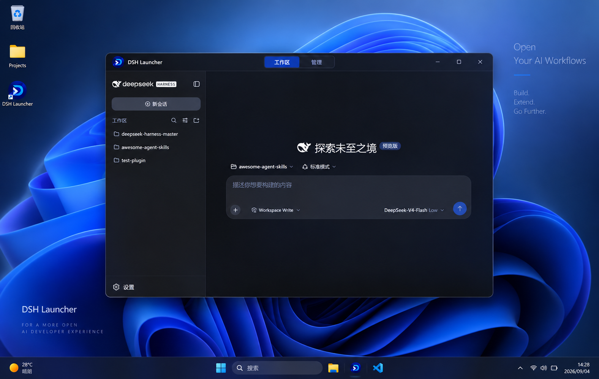
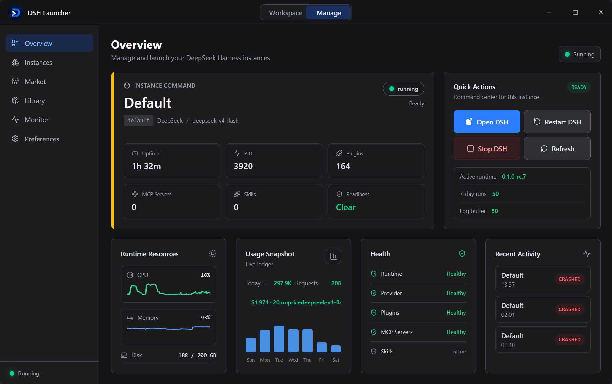
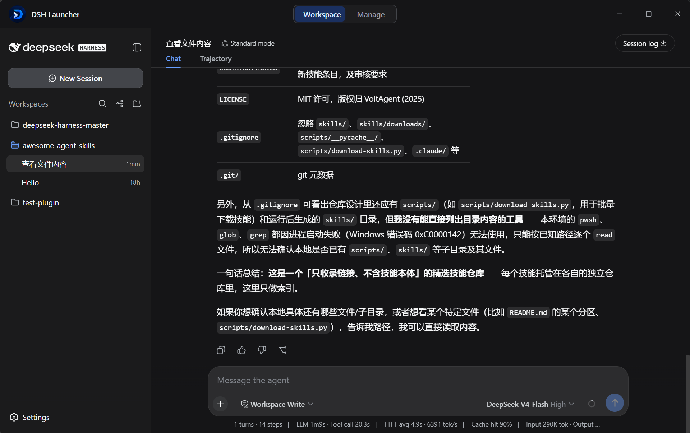
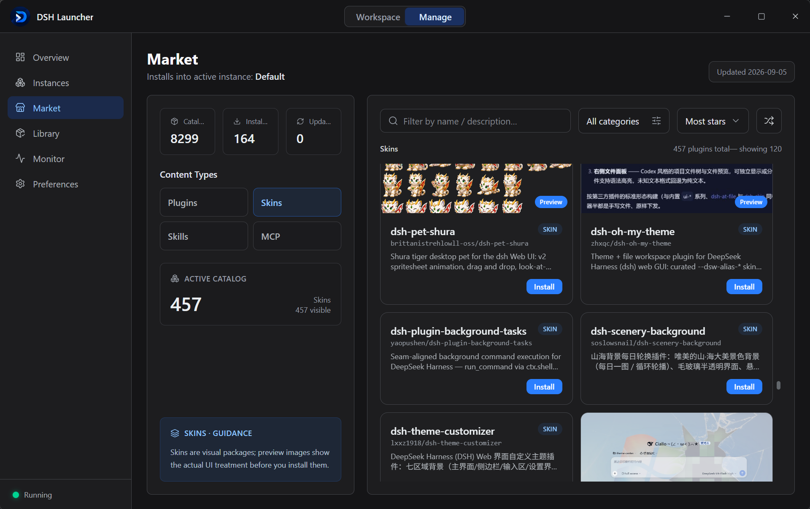
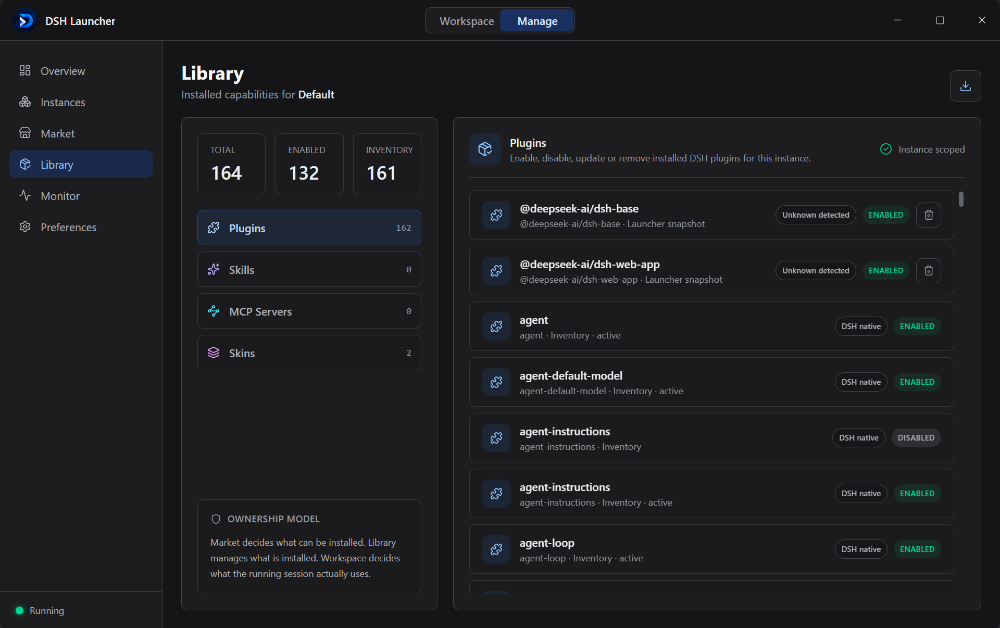
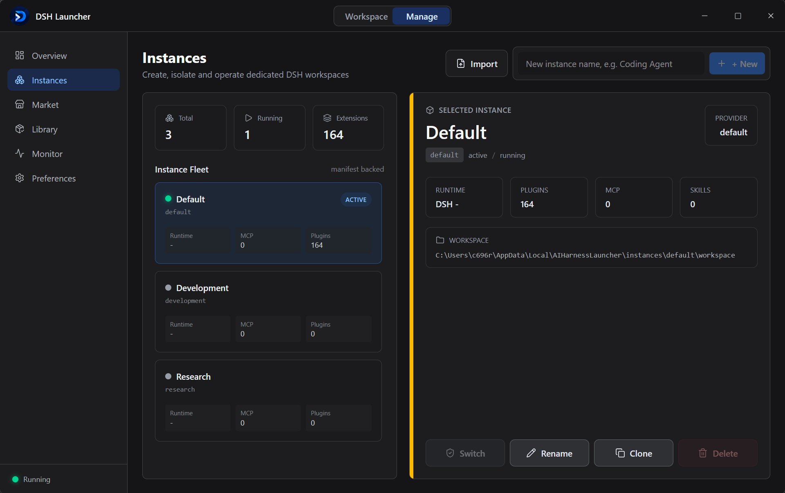

<p align="center">
  
</p>

<h1 align="center">DeepSeek Harness Launcher</h1>

<p align="center">
  <strong>The local runtime and ecosystem manager for DeepSeek Harness — one place for runtimes, instances, model providers, plugins, skills, MCP, and launch environments.</strong>
</p>

<p align="center">
  No manual environment setup. Works out of the box. The desktop shell is only one way to drive it; runtimes, instances, and ecosystem content are managed by DSHL.
</p>

<p align="center">
  <a href="https://github.com/rootkiller6788/dsh-launcher/releases/latest"></a>
  <a href="https://github.com/rootkiller6788/dsh-launcher/releases"></a>
  <a href="https://github.com/rootkiller6788/dsh-launcher"></a>
  <a href="LICENSE"></a>
  
  
  
  
</p>

DeepSeek Harness Launcher integrates the [DeepSeek Harness](https://github.com/deepseek-ai/deepseek-harness) local Web UI, host services, and plugin system into a native desktop application. It owns the window, the tray, the runtime, the work configuration, and updates, and composes with upstream capabilities through the plugin mechanism DeepSeek Harness provides. It pins and runs a specific upstream version as-is — no fork, no changes to upstream behavior.

<p align="center">
  
</p>
<p align="center">
  
</p>
<p align="center">
  
</p>
<p align="center">
  
</p>
<p align="center">
  
</p>

## Download and install

Installers are currently available for Windows x64 (Ubuntu support is coming). No extra runtime required — download, install, and use.

| Platform | Download | Install |
| --- | --- | --- |
| Windows x64 | [Download the installer](https://github.com/rootkiller6788/dsh-launcher/releases/latest) | Run the NSIS installer and follow the prompts |

### Building from source

Requirements: Node ≥ 22, pnpm ≥ 10, Rust (MSVC toolchain), WebView2 (already present on Windows 11).

```bash
pnpm install                 # frontend dependencies
cargo build --workspace      # compile every Rust crate
pnpm build                   # tauri build → NSIS setup.exe
# output: apps/desktop/src-tauri/target/release/bundle/nsis/*-setup.exe
```

## Features

- **A runtime that works out of the box** — Node 22 ships inside the installer; DSH is resolved through a four-layer chain (settings override → bundled → managed `runtimes/<ver>/` → PATH). No Node, no pnpm, no source checkout.
- **Managed runtimes** — install, switch, delete, and verify multiple DSH versions side by side; each instance is pinned to its own version.
- **Multi-instance isolation** — every instance gets its own `$DSH_HOME`; plugins and configuration never bleed between instances. Create, rename, clone, delete, switch.
- **Model providers** — API keys live in Windows Credential Manager and never touch disk in plaintext; a built-in provider library plus model catalog sync.
- **Plugin marketplace** — five catalogs (plugins / skins / skills / MCP / bundles); registry browsing, smart (LLM-reranked) search, and install / uninstall / hot enable-disable through the `cordis.patch.yml` layer, which survives reconciliation by `dsh plugin`.
- **MCP ecosystem** — probe detection at install time, config gaps made explicit (two signals: a self-reported degraded state and a 0-tool count), a config dialog to fill them in, and values stored in the OS credential store and injected into the launch environment.
- **Embedded DSH window** — DSH renders inside the launcher's own window rather than a browser tab; closing the window stops the harness.
- **Two-way theme sync** — light / dark / follow system, one switch: change it on either side, the launcher or DSH, and both follow.
- **Hardened process tree** — Windows Job Objects (`KILL_ON_JOB_CLOSE`) + recursive `taskkill /T /F` as a fallback + a pre-launch zombie sweep. Ten consecutive start/stop cycles leave zero residue.
- **Launch history** — sessions recorded in SQLite with start and end timestamps and crash / exit status.

## Quick start

1. **Install** and launch AI Harness Launcher.
2. **Preferences → Providers** — paste your DeepSeek API key (stored in Windows Credential Manager).
3. **Home** — pick an instance and click **Launch**.

DSH starts in its own window; the Activity panel streams stdout/stderr live. Click the same button — or close the window — to stop it.

## Repository layout

```
dsh-launcher/
├── apps/desktop/               Tauri 2 application
│   ├── src/                    React 19 + TS frontend (Vite, Tailwind v4, Zustand)
│   └── src-tauri/              Rust shell: commands/, state/, tauri.conf.json, vendor/node
├── crates/
│   ├── launcher-core/          Framework-agnostic core: paths/settings/instance/provider/process/runtime/market/mcp
│   └── dsh-adapter/            DSH-specific adapters (RuntimeAdapter implementations): runtimes/theme/mcp probe/import/resolver
├── tui/                        dsh-tauri reference mirror (embedded-window mechanics)
├── scripts/                    Development helpers (icon generation, catalog generation, resolvers)
└── docs/                       Documentation
```

**The language boundary is deliberate:** TypeScript owns the UI; Rust owns the system (processes, filesystem, network, secrets, SQLite). Every system action goes through typed Tauri IPC — see [`CONTRIBUTING.md`](CONTRIBUTING.md).

## Data directory

By default everything lives under `%LOCALAPPDATA%/AIHarnessLauncher/`. In **portable (green) mode** the root is the directory holding the exe — drop the exe (with its bundled resources) anywhere and every byte stays next to it, so the whole launcher can travel on a USB stick.

```
<root>/
├── settings.json            app settings (DSH path overrides, theme, recent instances)
├── providers.json           provider metadata (API keys are in Credential Manager, never here)
├── launcher.db              SQLite launch history
├── runtimes/                managed DSH versions + bundled node
├── instances/<id>/          instance.json + workspace/ (= that instance's $DSH_HOME)
├── cache/                   registry + download cache
└── logs/launcher.log        app log (plus crash-*.txt on panic)
```

## Environment variables

| Variable | Purpose |
| --- | --- |
| `AHL_HOME` | Override the data root (defaults to `%LOCALAPPDATA%/AIHarnessLauncher`; development / testing) |
| `AHL_PORTABLE` | Set to a truthy value (`1`, `yes`, `on`, …) to force portable mode: data root = the exe's own directory |
| `DSH_CLI_BIN` | Override the DSH CLI entry (`…/apps/cli/lib/bin.js`) |

## Portable (green) mode

Create an empty `portable` (or `.portable`) file next to the launcher exe and the next launch switches to portable mode: `runtimes/`, `instances/`, `settings.json`, `cache/`, `logs/`, and `launcher.db` all land beside the exe. Delete the marker to return to the per-user layout. The active mode is visible under Preferences → Data storage. API keys always stay in Windows Credential Manager and do not travel with the folder.

## Contributing

PRs are welcome — start with [`CONTRIBUTING.md`](CONTRIBUTING.md) (branch / commit conventions, PR flow, code and test standards).

## License

[MIT](LICENSE) © 2026 dsh-launcher contributors.
